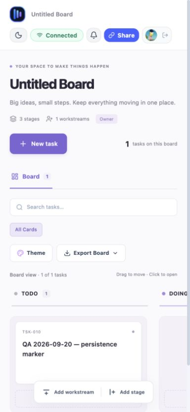

# Deployment validation — 20 September 2026

Target: https://kanban-board-eta-five.vercel.app/

## Release identity

The public site was inspected in a real browser. Its Dashboard still uses the earlier blue header and its Board uses “stages/workstreams”; the current local source uses shared workspace chrome and “columns/swimlanes”. The deployed commit could not be verified from hosting controls. Do not describe the new local features as released based on this report.

## Evidence and results

| Check | Result | Evidence / limit |
|---|---|---|
| Home page over HTTPS | Passed | Login and guest-demo buttons rendered. |
| Google login | Passed for existing Google session | Clicking Continue with Google returned an authenticated Dashboard. No credential was requested by the agent. Fresh consent/MFA paths were not exercised. |
| Authenticated board creation | Passed | Created an isolated QA board and reached Connected / Owner. |
| Save and reload | Passed | `QA 2026-09-20 — persistence marker` remained in TODO after browser reload; TSK-010. |
| Share dialog | Partial | Can edit and Can view options generate distinct links. Invite credentials deliberately omitted from this report and screenshots. |
| Viewer/editor enforcement | Not verified on production | A second independent authenticated identity is needed. Testing as the owner would not establish viewer restrictions. Local automated role checks are separate evidence. |
| Mobile layout | Partial pass | 390 × 844 viewport, measured page width 384px. Header, task and create controls visible; board columns scroll horizontally. Physical touch devices and all dialogs not covered. |
| Data after backend restart | Blocked | Render service URL supplied, but browser redirected to login. Waiting for user sign-in or a confirmed restart. No restart performed. Reload result must not be substituted. |
| Latest local changes deployed | Not verified | Visible public UI differs from local source. |

QA board: https://kanban-board-eta-five.vercel.app/b/790be336-8aec-45bc-a5e7-18c56e4508fa

The QA board was retained for restart testing. It contains only a test marker, not real task data.

## Complete the remaining checks

1. Record the deployed frontend/backend commit IDs; deploy compatible versions together when releasing the new mutation protocol.
2. Use a second account in an isolated browser session. Open a view invite and verify no mutation controls; verify the server rejects writes. Open an edit invite and create/move a uniquely named test task; confirm it arrives in the owner's window. Test revoked/private access as well.
3. Before restarting, record the QA board ID, task ID, title, column and count. Restart the backend from its hosting controls; record the completed restart event/time. Reopen the same board, verify the marker and reconnect, then create a second marker to prove writes still work.
4. Confirm database URL, persistent storage, stable JWT signing configuration and OAuth callback settings in hosting controls without copying secrets into documentation.
5. Repeat at mobile widths and, separately, on an actual phone. Record browser/device and failures.

A test is passed only with observed evidence; unchecked steps above are a plan, not a claim of completion.

Backend control: https://dashboard.render.com/web/srv-d9mdgptbedkc73dgjl60 (authentication required).
